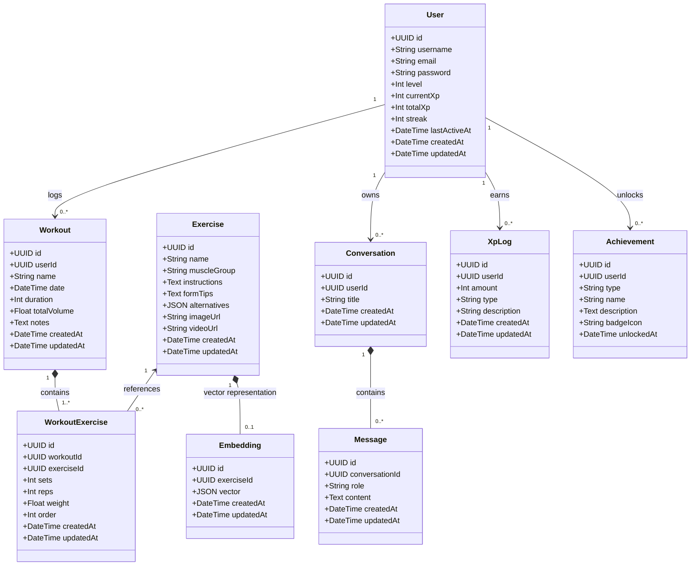

# HARD Platform — UML Class Diagram

This document contains the complete UML Class Diagram for the **HARD** backend architecture, database entities, and their relationships.

---

---

## 🏛️ Domain Breakdown

| Module | Entities | Key Responsibilities |
| :--- | :--- | :--- |
| **Core & Tracking** | `User`, `Workout`, `Exercise`, `WorkoutExercise` | User account lifecycle, workout execution logging, set/rep/weight tracking, and automatic volume recalculation. |
| **AI & RAG** | `Embedding`, `Conversation`, `Message` | 384-dimensional dense vectors for semantic similarity search, multi-turn chat persistence with user isolation. |
| **Gamification** | `XpLog`, `Achievement` | Immutable XP audit ledger, leveling mechanics, and milestone badge achievements. |
